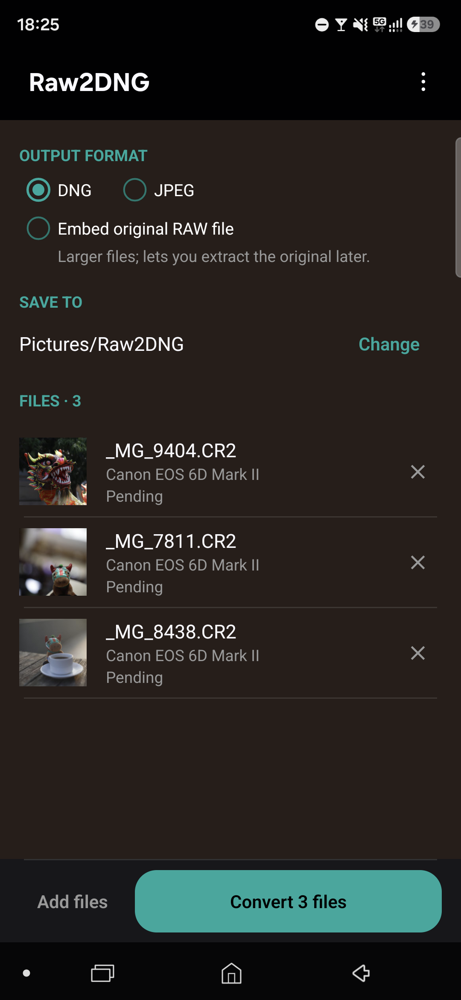
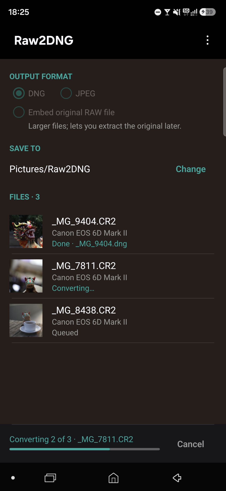
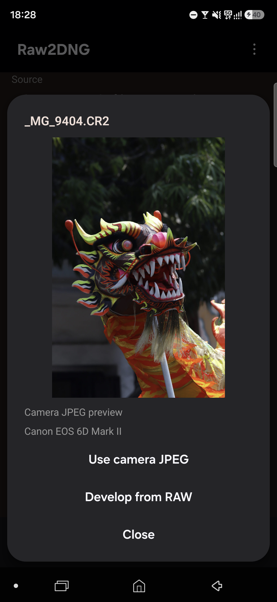
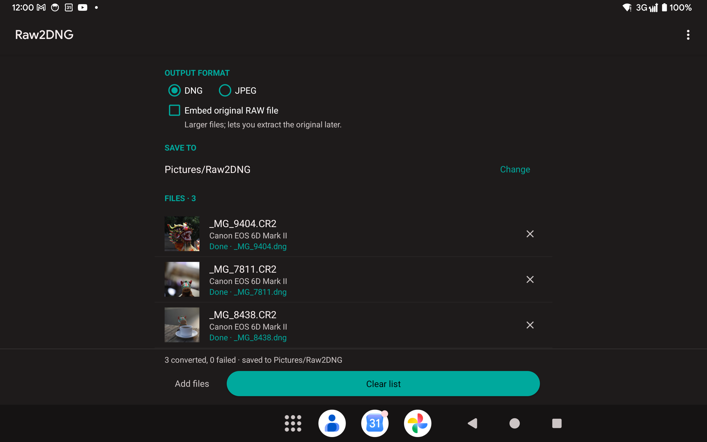
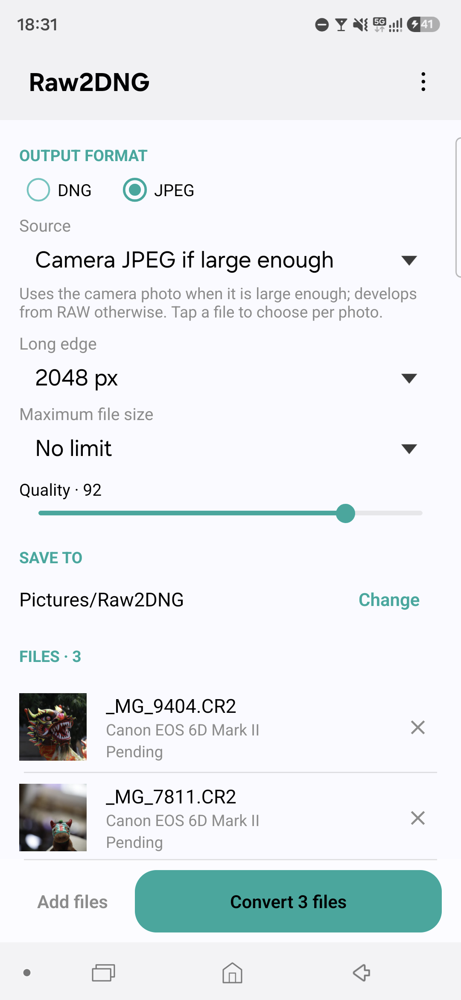

# Raw2DNG2

Convert your camera's RAW photos to DNG or JPEG, right on your phone.

<p align="center">
  
  
  
</p>

I shoot Canon RAW and wanted DNGs and quick JPEGs straight from my phone, without waiting until I'm back at a laptop. So this does exactly that. Pick your photos, choose DNG or JPEG, tap Convert.

## What it does

- **DNG** keeps the photo data exactly as your camera recorded it. I checked the output pixel by pixel against the original files.
- **JPEG** at full size, or shrunk to 1080, 2048 or 3840 px on the long edge, or any size you type in. You can also set a maximum file size, handy for sites that cap uploads.
- For JPEGs it uses the photo your camera already embedded in the RAW file when that's big enough, which is much faster. Tap a photo to see it and decide for yourself, or tell it to always develop from the RAW data.
- Share RAW files to it from your gallery or file manager, or pick them inside the app.
- Converted files go to **Pictures/Raw2DNG**, or a folder you choose.
- No account, no ads, no internet access. Your photos never leave the phone.
- Works on Android 5.0 and newer, phones and tablets, light and dark theme.

## Why make this?
The original Raw2DNG app that I used, available in the Google Play Store, is no longer maintained and cannot be installed on my recent phone anymore. It also has a quite clunky UI.

## Download

The current version is **v1.0.0 "Saint Lite"**. Grab the APK from the [latest release](https://github.com/fwibisono87/raw2dng2/releases/latest) and open it on your phone. Android will ask you to allow installs from your browser or file manager the first time.

## Which cameras?

Most of them. Raw2DNG uses the same engine as [dnglab](https://github.com/dnglab/dnglab), which reads RAW files from Canon (including CR3), Nikon, Sony, Fujifilm, Panasonic, Olympus and OM System, Pentax, Leica, Hasselblad and more. Here's the [full list](https://github.com/dnglab/dnglab/blob/main/rawler/SUPPORTED_CAMERAS.md). Sigma's Foveon cameras aren't supported.

If your camera isn't on the list, the app will tell you it can't read the file rather than make a bad copy.

## A few things worth knowing

- Files are converted one at a time, about a second each for a DNG on a recent phone.
- Developing a full-size JPEG from RAW needs a lot of memory (close to 1 GB for a 26 MP photo). On older phones, use the camera JPEG or pick a smaller size.
- "Embed original RAW file" stores the whole original inside the DNG, so you can get it back later. It roughly doubles the file size, so it's off by default.

<p align="center">
  
  
</p>

<details>
<summary><strong>Building it yourself</strong></summary>

You'll need:

- JDK 21
- Android SDK Platform 36, Build Tools 36.0.0 and NDK 28.2.13676358
- Rust (stable) with the Android targets:

  ```sh
  rustup target add aarch64-linux-android armv7-linux-androideabi x86_64-linux-android
  ```

Point Gradle at your SDK with `ANDROID_HOME`, or put `sdk.dir=/path/to/Android/Sdk` in `local.properties`. Then:

```sh
./gradlew :app:assembleDebug
./gradlew :app:assembleRelease
./gradlew :app:lintDebug
```

Gradle builds the Rust library for `arm64-v8a`, `armeabi-v7a` and `x86_64`. Add `-Prust.abis=arm64-v8a` to build just one while you're working.

Release builds are signed with a local debug key unless you pass `release.storeFile`, `release.storePassword`, `release.keyAlias` and `release.keyPassword` as Gradle properties.

For the current F-Droid metadata and source-build notes, see [docs/f-droid.md](docs/f-droid.md).

The Rust side can be tested on its own:

```sh
cd native
cargo test --release
RAW2DNG_SAMPLE=/path/to/photo.CR2 cargo test --release
```

**Releases:** every release gets a version and a codename. Set both in [`app/version.properties`](app/version.properties), commit, and push an annotated tag whose message is the codename:

```sh
git tag -a v1.0.0 -m "Saint Lite"
git push origin v1.0.0
```

The [release workflow](.github/workflows/release.yml) checks the tag against that file, builds a signed APK and publishes it as `v1.0.0 "Saint Lite"`. The About screen shows the same version and codename. Signing needs four repository secrets: `RELEASE_KEYSTORE_BASE64` (the keystore file, base64-encoded), `RELEASE_STORE_PASSWORD`, `RELEASE_KEY_ALIAS` and `RELEASE_KEY_PASSWORD`.

</details>

## Credits and license

The conversion is done by [rawler](https://github.com/dnglab/dnglab), the library behind dnglab, which is licensed under LGPL-2.1. Thanks to its authors for doing the hard part.

The rest of Raw2DNG is MIT licensed. See [LICENSE](LICENSE) and [NOTICE](NOTICE).
